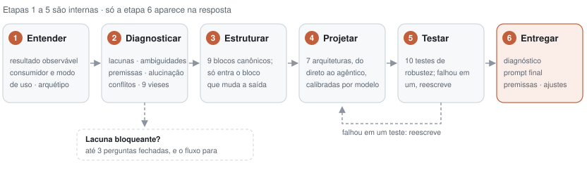

# Engenharia de Prompt para Claude

[](https://github.com/fernandofigueiredo-data/claude-prompt-engineer/actions/workflows/validar.yml)
[](https://github.com/fernandofigueiredo-data/claude-prompt-engineer/releases/latest)
[](LICENSE)

Uma skill para Claude que recebe uma ideia do jeito que ela está na sua cabeça, vaga e incompleta, e devolve o prompt que produz o resultado pretendido, com o mínimo de instruções necessárias e com toda premissa declarada.

O problema que ela resolve: a maior parte dos prompts falha não por falta de técnica, mas porque deixa o modelo adivinhar o formato, o escopo, o critério de sucesso e os fatos que ninguém forneceu. Esta skill diagnostica essas lacunas antes de escrever, pergunta só o que muda a forma da saída e calibra o texto para o modelo que vai executá-lo.

> **Em números:** 6 etapas de método · 7 arquiteturas de prompt com esqueleto pronto · 10 testes de robustez antes de cada entrega · 9 padrões de viés auditados · 32 blocos reutilizáveis e 14 antipadrões · 7 exemplos reais com saída integral e 1 comparação medida em dois modelos · calibração para 4 modelos atuais (Opus 5.5, Sonnet 5.5, Haiku 5.5, Fable 5.1) com fontes oficiais de 17/10/2026

<picture>
  <source media="(prefers-color-scheme: dark)" srcset="docs/metodologia-dark.svg">
  
</picture>

---

## Antes e depois

Um prompt real que *"não tá funcionando, os posts saem genéricos e enormes"*, enviado à skill para revisão:

```
Você é um especialista de nível mundial em marketing digital.
CRÍTICO: você DEVE SEMPRE pensar passo a passo e mostrar todo o seu raciocínio.
Escreva um post para LinkedIn sobre IA no trabalho. Máximo 150 palavras.
NÃO use emojis. NÃO use hashtags. NUNCA seja genérico.
Verifique sua resposta antes de enviar.
```

O diagnóstico da skill liga cada sintoma a uma causa: o tamanho vem do pedido de raciocínio visível e do limite em contagem de palavras; a genericidade vem da falta de matéria-prima, porque nenhum modelo é específico sobre "IA no trabalho" sem um caso concreto. `NUNCA seja genérico` vira um critério que se confere: toda afirmação precisa se apoiar no material fornecido.

<details>
<summary><b>Prompt revisado pela skill</b> (saída integral em <a href="exemplos/06-revisao-de-prompt.md">exemplos/06</a>)</summary>

```
Escreva um post para LinkedIn sobre IA no trabalho, a ser publicado no meu perfil pessoal.

<autor>
[Seu cargo, sua área e quem costuma te ler. Ex.: gerente de operações em uma rede de varejo; o público são gestores de empresas médias.]
</autor>

<material>
[Um fato concreto da sua experiência: algo que você testou, viu dar errado, mediu ou que te fez mudar de opinião. Ex.: "Passamos a usar IA para resumir chamados de suporte. O tempo de triagem caiu de 40 para 15 minutos, mas os atendentes pararam de ler os chamados inteiros."]
</material>

O post parte desse material e defende uma única ideia, com a qual um leitor poderia discordar. Um post de LinkedIn fica genérico quando fala de IA sem caso, número ou posição. Por isso, toda afirmação deve se apoiar no material acima, e nada que não esteja nele pode aparecer como fato, número ou experiência do autor.

Formato:
- De três a quatro parágrafos curtos, com seis a oito frases no total.
- A primeira frase apresenta o fato concreto ou a tensão do caso, sem introdução sobre o tema.
- A última frase é uma posição ou uma pergunta específica sobre o caso, e não uma conclusão inspiracional.
- Texto corrido, em primeira pessoa, com o vocabulário de quem fala com colegas da área. Sem emojis, hashtags, listas ou negrito.

Entregue apenas o texto do post, pronto para colar.
```

</details>

**O resultado, medido.** Os dois prompts rodaram três vezes cada no Claude Opus 5.5, e o original rodou também com o mesmo relato colado no fim, para separar o efeito do material do efeito da reescrita:

| Variante | Palavras na resposta | Texto além do post | Caso declarado como inventado | Detalhes do relato usados (de 7) | Emoji ou hashtag |
|---|---|---|---|---|---|
| Original | 233 (186–278) | 3 de 3 | 3 de 3 | 0,7 (0–1) | 0 de 3 |
| Original + o mesmo material | 316 (280–350) | 3 de 3 | 0 de 3 | 6,0 (6–6) | 0 de 3 |
| Revisado pela skill | 165 (141–188) | 0 de 3 | 0 de 3 | 5,0 (5–5) | 0 de 3 |

O material explica a especificidade: com o mesmo relato, o prompt original também escreve um post concreto. A reescrita explica o resto. O original devolve o post cercado de bastidores, contagem de palavras ou avisos em todas as execuções e, sem relato, inventa um caso com números fictícios nas três; o revisado devolve só o post, pronto para colar. O padrão se repete no Claude Opus 5. Método, limites, prompts exatos e as dezoito saídas em [`exemplos/resultados-06/`](exemplos/resultados-06/).

## Instalação

**Claude Code, como plugin** (recomendado: recebe atualizações):

```bash
claude plugin marketplace add fernandofigueiredo-data/claude-prompt-engineer
```

```bash
claude plugin install engenharia-de-prompt@claude-prompt-engineer
```

A skill dispara sozinha quando você descreve uma tarefa para IA, pede um prompt ou cola um prompt que não funcionou. Para chamá-la diretamente: `/engenharia-de-prompt:engenharia-de-prompt sua ideia aqui`.

**claude.ai, como skill.** Baixe `engenharia-de-prompt.zip` da [Release mais recente](https://github.com/fernandofigueiredo-data/claude-prompt-engineer/releases/latest) e envie na área de Skills das configurações do claude.ai.

**Project ou Cowork, sem skills.** Cole o conteúdo de [`instrucoes/INSTRUCOES-PROJECT-COWORK.md`](instrucoes/INSTRUCOES-PROJECT-COWORK.md) no campo de Instruções. É uma versão condensada e autossuficiente: transforma o ambiente inteiro num gerador de prompts.

## Como usar

Escreva a ideia como estiver, mesmo incompleta, e diga o modelo alvo se souber. A resposta vem sempre no mesmo formato:

| Bloco | O que traz |
|---|---|
| **DIAGNÓSTICO** | resultado pretendido, arquétipo, modo de uso e o ponto que mais condiciona a qualidade do prompt |
| **PROMPT FINAL** | um bloco de código único, pronto para copiar |
| **PREMISSAS / LACUNAS** | cada decisão tomada sem dados, marcada como `assumido` ou `indefinido` |
| **AJUSTES OPCIONAIS** | só quando houver ganho real: variante para outro modelo, versão para pipeline |

Quando falta algo que mudaria a forma da saída, vêm até três perguntas fechadas em vez do prompt. A skill nunca executa a tarefa descrita: ela escreve o prompt que levaria um modelo a executá-la.

## Exemplos reais

Sete entradas, com as saídas integrais e sem edição, geradas pela skill em execuções independentes (Claude Opus 5.5 via Claude Code, 17/10/2026). Comando de reprodução em [`exemplos/`](exemplos/).

| Exemplo | Arquitetura | O que mostra |
|---|---|---|
| [Pedido vago de uso único](exemplos/01-ideia-vaga.md) | B enxuto, com campos preenchíveis | lacuna de dados vira campo, não pergunta; regra com motivo |
| [Análise com premissa embutida](exemplos/02-analise-com-premissa.md) | B + tratamento de incerteza | `por que fracassou` vira medição; causas avaliadas com evidência a favor e contra |
| [Instrução persistente de Project](exemplos/03-instrucao-de-project.md) | E | citação antes da análise; severidade definida por consequência |
| [Pipeline de extração em JSON (Haiku 5.5)](exemplos/04-pipeline-json.md) | F | categorias fechadas; entrada malformada prevista; prompt estático para cache |
| [Agente autônomo de longa duração](exemplos/05-agente-autonomo.md) | G | linha de base, worktree isolado, precedência e critério de parada |
| [Revisão de um prompt que não funciona](exemplos/06-revisao-de-prompt.md) | B enxuto | antipadrões removidos e explicados; efeito medido |
| [Pedido sem informação suficiente](exemplos/07-lacuna-bloqueante.md) | nenhuma: perguntas | três perguntas fechadas em vez de um molde genérico |

## O método

**Três compromissos.** *Fidelidade*: melhora a execução, nunca o sentido do pedido. *Não fabricação*: lacuna vira premissa declarada ou pergunta, nunca invenção. *Não substituição de juízo*: vieses do pedido ficam visíveis, mas a decisão continua com quem pediu.

**Seis etapas**, das quais só a última aparece na resposta:

1. **Entender** o resultado observável, quem consome a saída, o modo de uso (pedido único, instrução persistente ou pipeline) e o arquétipo da tarefa.
2. **Diagnosticar** lacunas (bloqueantes, assumíveis, irrelevantes), ambiguidades, premissas embutidas, risco de alucinação, conflitos internos e nove padrões de viés.
3. **Estruturar** em blocos canônicos (`<papel>`, `<contexto>`, `<tarefa>`, `<formato_de_saida>`...). Um bloco só entra se alterar a saída.
4. **Projetar** com uma de sete arquiteturas:

   | | Arquitetura | Quando |
   |---|---|---|
   | A | Direto | tarefa única, formato óbvio; a escolha certa mais vezes do que se supõe |
   | B | Estruturado | vários tipos de conteúdo no mesmo prompt |
   | C | Guiado por exemplos | a forma é mais fácil de mostrar que de descrever |
   | D | Documento longo | material acima de 20 mil tokens |
   | E | Instrução persistente | system prompt, Project, Cowork |
   | F | Pipeline | chamada programática com saída consumida por código |
   | G | Agêntica | ferramentas, autonomia, critério de parada |

5. **Testar** o rascunho contra dez testes: leitor sem contexto, instrução supérflua, contradição, escopo, alucinação, viés, formato verificável, indução por exemplos, calibração do modelo e jargão.
6. **Entregar** no formato fixo.

**Calibração por modelo.** O mesmo resultado pede textos diferentes em cada modelo. Alguns exemplos do que está em [`calibracao-por-modelo.md`](plugins/engenharia-de-prompt/skills/engenharia-de-prompt/references/calibracao-por-modelo.md):

- Opus já verifica o próprio trabalho: instruções herdadas de `verifique sua resposta` causam verificação redundante e saem. Sonnet 5.5 e Haiku 5.5 em esforço baixo, em código, às vezes declaram pronto sem rodar nada: ali a instrução de verificação real entra.
- Sonnet e Haiku interpretam ao pé da letra: `aplique a todas as seções, não apenas à primeira` precisa ser escrito.
- Pedir o raciocínio escrito na resposta pode ser recusado na família 5.5; pede-se uma explicação curta da resposta.
- Fable 5.1 formata menos que os modelos anteriores, então regras antiformatação herdadas o fazem subformatar.

## Estrutura do repositório

```
.claude-plugin/marketplace.json        marketplace com um plugin
plugins/engenharia-de-prompt/
  .claude-plugin/plugin.json
  skills/engenharia-de-prompt/
    SKILL.md                           método, regras e formato de saída
    references/
      calibracao-por-modelo.md         Opus 5.5, Sonnet 5.5, Haiku 5.5, Fable 5.1, API
      arquiteturas-de-prompt.md        as sete arquiteturas com esqueleto pronto
      auditoria-de-vieses.md           nove padrões, detecção e correção
      blocos-reutilizaveis.md          32 blocos prontos e 14 antipadrões
instrucoes/INSTRUCOES-PROJECT-COWORK.md versão autossuficiente para colar
exemplos/                              casos reais com entrada e saída integrais
scripts/                               validação, empacotamento e diagrama
```

A cada push, o CI roda [`scripts/validar.py`](scripts/validar.py) (manifestos, frontmatter, referências citadas e links internos), o validador oficial `claude plugin validate` e o empacotamento do zip.

## O que a skill não faz

- Não executa a tarefa contida no pedido, nem quando o pedido é uma pergunta.
- Não completa dados, números, nomes ou fontes ausentes.
- Não corrige a opinião de quem pede; torna as premissas visíveis.
- Não garante o comportamento do modelo: a calibração reflete a documentação na data de consulta, e o comportamento muda entre versões.

## Fontes

Documentação oficial da Anthropic, consultada em 17 de outubro de 2026: [Prompting best practices](https://platform.claude.com/docs/en/build-with-claude/prompt-engineering/claude-prompting-best-practices) e os guias específicos de [Opus 5.5](https://platform.claude.com/docs/en/build-with-claude/prompt-engineering/prompting-claude-opus-5-5), [Sonnet 5.5](https://platform.claude.com/docs/en/build-with-claude/prompt-engineering/prompting-claude-sonnet-5-5), [Haiku 5.5](https://platform.claude.com/docs/en/build-with-claude/prompt-engineering/prompting-claude-haiku-5-5) e [Fable 5.1](https://platform.claude.com/docs/en/build-with-claude/prompt-engineering/prompting-claude-fable-5-1). Material complementar de um curso de engenharia de prompts foi usado nos pontos que continuam válidos, como a distinção entre clareza e especificidade e o limite de extensão em frases em vez de palavras. Onde as fontes divergiam, prevaleceu a documentação oficial, e as técnicas descartadas estão registradas como antipadrões.

## Contribuir

Ajustes de calibração precisam de fonte oficial com data; novos exemplos seguem o formato de [`exemplos/`](exemplos/). Veja [CONTRIBUTING.md](CONTRIBUTING.md) e o [CHANGELOG](CHANGELOG.md).

## Licença

[MIT](LICENSE) · Fernando Figueiredo
